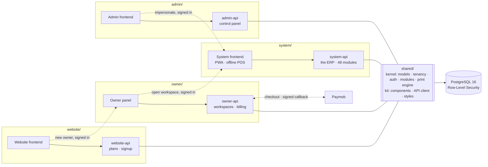

<div align="center">


# ميزان · Mizan

### أدر أعمالك بتوازن.
**One system for every kind of business.**

An Arabic-first, multi-tenant ERP that shapes itself around the business using it,
whether that's a corner shop, a restaurant, a pharmacy, a hotel or a factory.

[](https://github.com/ammar0xff/Mizan/actions/workflows/ci.yml)
&nbsp;
&nbsp;

[**Website**](https://mizan-co.vercel.app) &nbsp;·&nbsp;
[**Open the app →**](https://mizan-co-app.vercel.app) &nbsp;·&nbsp;
[Owner account](https://mizan-co-owner.vercel.app) &nbsp;·&nbsp;
[Admin](https://mizan-co-admin.vercel.app) &nbsp;·&nbsp;
[API docs](https://mizan-co-api.vercel.app/api/docs) &nbsp;·&nbsp;
[Documentation](docs/)

</div>

---

## What is Mizan?

*Mizan* (ميزان) is Arabic for **balance**, the scale a merchant uses to weigh goods fairly.
The product is built on the same idea: everything a business does (selling, stocking, buying,
paying people, keeping the books) recorded in **one balanced system** instead of spreadsheets,
paper ledgers and disconnected cash registers.

It is built **for Egypt first**: Arabic interface, Egyptian pound, Cairo time, 14% VAT,
Egyptian payroll law, Vodafone Cash / InstaPay wallets and thermal receipts with tax QR codes.

## How it works: three questions

```
  ① What does your business do?     →  pharmacy, restaurant, retail, clinic, factory …
  ② How big is it?                  →  one shop, a few branches, an enterprise
  ③ What should it look like?       →  your brand colour, your logo, the features you want
                                       ↓
          Your own workspace, already filled with realistic demo data
          for your sector. Free for 14 days.
```

The chosen **business activity** is the key. It decides which modules switch on, what the
screens look like, and how you work in them. The point-of-sale module, for example:

| A restaurant sees | A retail shop sees | A pharmacy sees |
|---|---|---|
| a floor plan, open tickets, a kitchen display | a two-pane checkout, barcode + numpad, `F2` `F3` `Esc` | a search-first drug list, batch expiry colours, substitutes |

Same engine, same data, **a different tool for every trade.**

---

## Everything in one place

### The shared core: every workspace gets this

| | |
|---|---|
| 🧾 **Point of sale** | Barcode scanning, retail/wholesale prices, credit sales with limits, split payments, hold & resume, cashier shifts, **works offline** and syncs later |
| 📄 **Sales** | Invoices, quotations → invoices, partial and full returns, branded Arabic PDF invoices, Excel export |
| 📦 **Inventory** | Multi-warehouse stock, transfers, stocktaking, adjustments, reorder levels with low-stock alerts |
| 🛒 **Purchasing** | Supplier invoices, purchase orders and receiving, price history, supplier statements |
| 👥 **Customers & suppliers** | Running balances, credit limits, statements, collections |
| 💰 **Finance** | Cash safes, e-wallets, expenses, general ledger, trial balance, journal vouchers, monthly period close |
| 🧑‍💼 **HR & payroll** | Employees, attendance (CSV or ZKTeco fingerprint devices), payroll run draft → review → approve → pay, payslips |
| 📊 **Reports** | Sales, stock, cash flow, debt aging, and a dashboard built around *today's sales* |
| 🔔 **Everyday comfort** | Notification centre, `Ctrl+K` command palette, light/dark mode, Arabic ⇄ English switch, installable as an app (PWA) |

### Industry modules: switched on by your activity

Mizan's long-term map covers **30 business types**. Each one is a self-contained module
that plugs into the shared core.

| Family | Modules |
|---|---|
| **Shops & dining** | Retail POS · Supermarket fast-scan · Restaurant & café · Kitchen display (KDS) · Pharmacy |
| **Distribution** | Wholesale · Logistics & fleet · 3PL warehousing (WMS) · E-commerce · Online storefront |
| **Services** | Clinic & hospital · Law firm · Travel agency · Hotel (PMS) · Gym · Salon & spa · Creative/translation agency · Field service · School · Professional services |
| **Manufacturing** | Discrete assembly · Food & beverage (HACCP) · Pharmaceutical (GMP) · Printing & packaging |
| **Projects & land** | Construction · Real estate · Agriculture · Energy & power plants |
| **Specialised** | Banking · Insurance · Government & NGOs · Entertainment & events · Oil & gas |
| **Connectors** | WhatsApp Business receipts · ZKTeco attendance · Thermal printers & barcode scanners |

> **Honest status.** The core and the Shops & dining family are the most mature. Most other
> industry modules are **scaffolded**: their data, API and screens exist, but depth varies from
> module to module. See [Where things stand](#where-things-stand).

---

## Plans

| | Trial | Starter | Pro | Enterprise |
|---|:---:|:---:|:---:|:---:|
| **Price / month** | Free · 14 days | 450 EGP | 850 EGP | 1,950 EGP |
| **Price / year** | — | 4,500 EGP | 8,500 EGP | 19,500 EGP |
| **Users** | 3 | 5 | 15 | Unlimited |
| **Branches** | 1 | 1 | 3 | Unlimited |
| **Sales invoices / month** | 100 | 500 | 5,000 | Unlimited |
| **Industries** | Core | Core + Phase 1 | Phases 1–3 | All 30 |

Prices come from `shared/backend/app/core/plans.py`, which is the source of truth.

---

## Under the hood

Mizan is **four products, built and deployed separately**, on one shared kernel and one database:

| | Product | Who uses it | Lives at |
|---|---|---|---|
| 🌐 | **Website**: landing, pricing, docs, signup, onboarding | Visitors and new merchants | [mizan-co.vercel.app](https://mizan-co.vercel.app) |
| 🧾 | **System**: the ERP itself, plus public storefronts | Every workspace, every day | [mizan-co-app.vercel.app](https://mizan-co-app.vercel.app) |
| 🔑 | **Owner panel**: an owner's workspaces, subscriptions and Paymob payments (Arabic) | Business owners | [mizan-co-owner.vercel.app](https://mizan-co-owner.vercel.app) |
| 🛡️ | **Admin**: the platform control panel (English) | The Mizan team only | [mizan-co-admin.vercel.app](https://mizan-co-admin.vercel.app) |



Customers never download admin code, a pricing-page edit can't break the POS, and every
API exposes only its own routes. Apps hand a session to each other through a one-time handoff
in the URL fragment: signing up on the website opens the owner panel, and "Open workspace" there
(or "Open as owner" in the admin panel) opens the ERP already signed in.

| Layer | Technology |
|---|---|
| **Backend** | Python 3.12 · FastAPI · SQLAlchemy 2.0 (async) · Pydantic v2 · PostgreSQL 16 (Neon) |
| **Frontend** | React 19 · TypeScript (strict) · Vite · Tailwind CSS v4 · shadcn/ui on Base UI · TanStack Query · Zustand · Motion · Recharts |
| **Hosting** | Vercel (8 projects: 4 frontends + 4 APIs) · Neon (one database) · Docker Compose for local and on-premise |

### Four ideas that hold it together

**1. Every business is sealed off from every other.**
Each row carries a `tenant_id`, and isolation is enforced three times: an automatic ORM
filter, automatic stamping on insert, and **PostgreSQL Row-Level Security** as a final wall
inside the database. If an application bug forgets a filter, the database still says no.

**2. Modules are plug-ins, not forks.**
Every module has a backend folder (`shared/backend/app/modules/<id>/`) with a `manifest.json`
(category, dependencies, permissions, business types), its own models and API router, and its
screens in `system/frontend/src/modules/<id>/`. The marketplace at
`/modules` turns them on and off per workspace, and every route is guarded by `require_module`.

**3. Permissions mirror real jobs.**
Mizan separates **positions** (what someone does: pharmacist, cashier, chief accountant;
98 are catalogued), **account types** (their licence tier) and **permissions**
(`scope:action` tokens). Clinical records are fenced off from non-clinical staff, and a
logged, time-limited **break-glass** override exists for emergencies.

**4. Money is treated like money.**
Amounts are stored as exact decimals, never floats. Postings are atomic. Financial records
are never hard-deleted, and every destructive action leaves an audit trail.

### Owners and staff sign in in different places

| Where | Who | Opens |
|---|---|---|
| The app's [`/login`](https://mizan-co-app.vercel.app/login) (the website's **Sign in**) | Business owners | The **owner panel**: every workspace they own, trials, subscriptions, invoices |
| A workspace's login page (`/c/<workspace>/login`) | Staff, and owners working in one workspace | The **ERP** for that workspace |

An **owner account** (`owner_accounts`) owns any number of workspaces. In each one the owner
also has an ordinary admin user with the same username and password; "Open workspace" signs
in as that user. New owners land in the panel after signup, where a short interactive tour
shows their workspace, how to open it, the trial, subscriptions and invoices. Subscribing
happens only here: the owner picks a plan, pays through **Paymob**, and Paymob's HMAC-signed
callback activates it. Nothing inside a workspace can change its plan. See
[`owner/README.md`](owner/README.md).

### The admin panel

A separate English app on its own domain, for the Mizan team only. It opens on **Needs you**
(ended trials, unpaid invoices, upgrade requests) and covers every workspace (plan, trial,
modules, people, suspend, open as owner, delete), billing with manual payment confirmation,
the team's access, live system health, and an activity log of every change. Every number
comes from the database. See [`admin/README.md`](admin/README.md).

---

## Design

Mizan is designed for people who sit in it **eight to twelve hours a day**, so it aims to be
calm, dense and fast, not flashy.

- **Look: warm editorial.** Oxblood `#651E2C`, Deep Merlot `#35151D`, Warm Ivory `#F5EBDD`,
  Charcoal `#262321`. Each workspace can re-tint the brand colour; status colours never change meaning.
- **Type:** IBM Plex Sans Arabic for the interface, Manrope for Latin text. Numbers are always
  Western digits in tabular alignment (`ar-EG-u-nu-latn`).
- **Composition: «دفتر اليوم», the daily ledger.** Screens read like a merchant's ledger page,
  not a generic admin template: one dominant figure, open ruled tables, status as a dot and a word.
- **Every screen has five states** (loading, empty, error, no-permission, full) and one clear primary action.
- **Accessibility target:** WCAG 2.2 AA, full keyboard use, and respect for *reduce motion*.

The full canon lives in [`docs/DESIGN_SYSTEM.md`](docs/DESIGN_SYSTEM.md),
[`docs/UI_UX_GUIDELINES.md`](docs/UI_UX_GUIDELINES.md) and [`docs/ui-ux-kit/`](docs/ui-ux-kit/).

---

## Where things stand

| Status | What |
|---|---|
| ✅ **Live** | Multi-tenant SaaS · self-serve signup & onboarding · owner panel with multiple workspaces per owner · POS (online + offline) · sales · inventory · purchasing · customers & suppliers · finance & ledger · HR & payroll · reports · notifications · storefront · thermal printing & barcode scanning · ZKTeco sync · Arabic/English · admin panel · plan limits · workspace suspension |
| 🧱 **Working, being deepened** | Restaurant & kitchen display · pharmacy · clinic (billing, clinical roles, FEFO dispensing, claims) · hotel PMS · school · gym · salon · wholesale |
| 🪴 **Scaffolded** | Manufacturing, projects, specialised and remaining service modules: models, API and screens exist, with workflows still to be filled in |
| 🔌 **In progress** | WhatsApp receipts (configured and logged; live sending queued) · Paymob payments (built and tested against signed callbacks; needs the production keys) · subscription expiry (paid periods are tracked; lapsing to read-only isn't automatic yet) |
| 🗺️ **Planned** | Egyptian Tax Authority e-invoicing · loyalty points · desktop, LAN and bring-your-own-database deployment modes · full hospital suite (EMR, inpatient, radiology, theatre) |

The roadmap lives in [`TASKS.md`](TASKS.md) and [`docs/DEVELOPMENT_ROADMAP.md`](docs/DEVELOPMENT_ROADMAP.md).
Independent audits, and what was fixed after them, live in [`docs/audit/`](docs/audit/).

---

## Run it locally

**Requirements:** Docker, Node 22+ (CI uses 24), Python 3.12+. Everything else goes through one file:

```bash
python manage.py setup     # npm deps, .venv, database + 4 APIs, migrations, first admin
python manage.py dev       # every frontend in one terminal (or: dev system | website | owner | admin)
python manage.py doctor    # what's installed, what's running, what to fix
```

| | URL | Talks to |
|---|---|---|
| System (ERP) | http://localhost:5173 | system-api on :8000 |
| Website | http://localhost:5174 | website-api on :8001 |
| Owner panel | http://localhost:5176 | owner-api on :8003 |
| Admin panel | http://localhost:5175 | admin-api on :8002 |

**A new database starts empty.** Docker loads a structure-only baseline
(`shared/backend/app/db/baseline_schema.sql`, no data), the API builds the rest of the schema,
and `db migrate` creates one workspace (“ميزان”) with two accounts: `ammar` / `changeme` for the
app and the owner panel, and `platform` / `changeme` for the admin panel (override with `MIZAN_ADMIN_*` and
`MIZAN_PLATFORM_*` `_USERNAME` / `_PASSWORD`). The bootstrap does nothing once any user exists.
Change both passwords after the first sign-in. To get a sector's demo data,
sign up a new workspace through the website.

### Everything `manage.py` does

```
setup | doctor
stack   up [--build] | down | restart [svc] | status | logs [svc] | build | update | shell [svc]
db      migrate | backup | restore <file> | backups | reset | baseline | export | psql
dev     [system|website|owner|admin|all]    build [system|website|owner|admin|all]
test    [unit|backend|e2e|all]              lint | check
vercel  status | domains | redeploy <project>
cron    [--job NAME]
```

- **`stack update`** backs up, rebuilds, restarts and migrates without losing data. **`db reset`** wipes everything.
- **`db baseline`** refreshes the baseline schema from your database (structure only, never data).
- **`db export`** writes master data (no transactions) to `backups/`, which git ignores.
- **`check`** runs what CI runs except e2e: ruff, TypeScript, unit and backend tests, and every build.
- `--yes` skips confirmations, `--verbose` prints every command. Only the Python standard library is needed.

### Tests

```bash
python manage.py test            # frontend unit tests + backend tests
python manage.py test e2e        # live API suite against the local stack (~3 min)
python manage.py check           # lint + tests + builds
```

Backend tests delete the workspaces they create, so the database is left as they found it.
CI runs lint, every build, unit tests, an import check of every API and the full
Docker-based end-to-end suite on every push.

---

## Shipping changes

Every product deploys on its own. Each Vercel project watches `master` and **rebuilds only
when its own folder or `shared/` changes**, so a website edit never redeploys the ERP.

| Vercel project | Folder | Domain |
|---|---|---|
| `mizan-website` | `website/frontend` | mizan-co.vercel.app |
| `mizan-website-api` | `website/backend` | mizan-co-web-api.vercel.app |
| `mizan-system` | `system/frontend` | mizan-co-app.vercel.app |
| `mizan-system-api` | `system/backend` | mizan-co-api.vercel.app |
| `mizan-owner` | `owner/frontend` | mizan-co-owner.vercel.app |
| `mizan-owner-api` | `owner/backend` | mizan-co-owner-api.vercel.app |
| `mizan-admin` | `admin/frontend` | mizan-co-admin.vercel.app |
| `mizan-admin-api` | `admin/backend` | mizan-co-admin-api.vercel.app |

- **`master` is production.** Work on a branch named after the product (`system/pos-discounts`,
  `website/new-hero`, `shared/fix-rounding`); pushing it gives you preview links for the apps you touched.
- **Commit as `ammar0xff`.** Vercel blocks deploys from commits it can't match to the account.
- **Changing `shared/` rebuilds every product**, so check every app that uses what you changed.
- **`python manage.py vercel status`** shows what's live on each project; `vercel redeploy <project>` redeploys one.
- The four APIs share one database and one `SECRET_KEY`; their settings live in each Vercel project.

---

## Repository map

```
system/                 the ERP
  frontend/src/         app shell, ERP screens, tenant routing, modules/ (industry screens)
  backend/              system-api: main.py + system_api/ (routes, tenant resolution)
website/                the public website
  frontend/src/         landing, product, pricing, blog, docs portal, signup, onboarding
  backend/              website-api: plans and self-serve signup
owner/                  the owner panel (Arabic): an owner's workspaces, subscriptions, Paymob
  frontend/src/         workspaces, workspace (plans, pay), invoices, account, payment return, tour
  backend/              owner-api: owner_api/ (account, workspaces, billing + Paymob callback)
admin/                  the admin panel (English, Mizan team only)
  frontend/src/         overview, workspaces, billing, activity, team, system
  backend/              admin-api: admin_api/ (one router per page)
shared/                 code every product uses
  frontend/src/         design kit (components/kit), API client, stores, i18n, styles, pricing
  backend/app/          kernel: factory, core (tenancy, auth, plans, printing), models, services,
                        api/routers (ERP endpoint library), modules (48 domain modules),
                        db (baseline schema, migrations, bootstrap)
e2e/                    live API end-to-end suite
docs/                   product, architecture, design, security and requirements docs
.github/                CI workflow
docker-compose.yml      local stack: database + the four APIs
package.json            npm workspaces: shared + the four frontends
manage.py               the one CLI: setup, stack, db, dev, build, test, lint, vercel
```

Frontend import aliases: `@/` is the shared kit, `@app/` is the current app, `@modules/` is the industry screens (system only).
Each product folder has its own README: [`system/`](system/README.md) · [`website/`](website/README.md) · [`owner/`](owner/README.md) · [`admin/`](admin/README.md) · [`shared/`](shared/README.md).

## Documentation

| Start here | Then |
|---|---|
| [Project overview](docs/PROJECT_OVERVIEW.md) | [Requirements (SRS)](docs/developer/mizan/srs/SRS-Mizan-v1.0.md) · [30-industry specs](docs/srs/00_MASTER_INDEX.md) |
| [System architecture](docs/SYSTEM_ARCHITECTURE.md) | [Why separate products (ADR-003)](docs/decisions/ADR-003-separate-apps.md) · [Owner accounts & Paymob (ADR-004)](docs/decisions/ADR-004-owner-accounts-and-payments.md) · [ADRs](docs/decisions/) · [Database & tenancy](docs/DATABASE_DESIGN.md) · [API standards](docs/API_STANDARDS.md) |
| [Security standards](docs/SECURITY_STANDARDS.md) | [Roles & permissions](docs/USER_ROLES_AND_PERMISSIONS.md) |
| [Design system](docs/DESIGN_SYSTEM.md) | [UI/UX kit](docs/ui-ux-kit/) · [Brand identity](docs/developer/mizan/frontend/08-brand-identity-full.md) |
| [Engineering standards](docs/ENGINEERING_STANDARDS.md) | [Contributor & agent rules](AGENTS.md) |

---

<div align="center">

**ميزان**: نظام واحد. رؤية أوضح. نمو أذكى.

<sub>Made in Egypt · Private repository · All rights reserved</sub>

</div>
