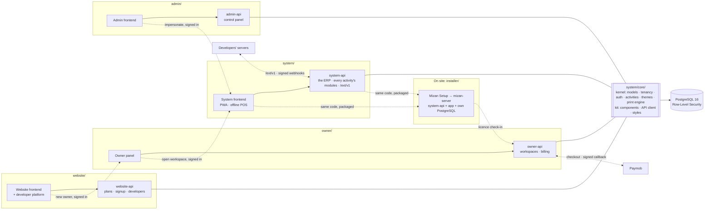

<div align="center">


# ميزان · Mizan

### أدر أعمالك بتوازن.
**One system for every kind of business.**

An Arabic-first, multi-tenant ERP that shapes itself around the business using it,
whether that's a corner shop, a restaurant, a pharmacy, a hotel or a factory.

[](https://github.com/mizan-corp/Mizan/actions/workflows/ci.yml)
&nbsp;
&nbsp;

[**Website**](https://allmizan.live) &nbsp;·&nbsp;
[**Owner sign-in →**](https://allmizan.live/login) &nbsp;·&nbsp;
[Admin](https://allmizan.live/admin) &nbsp;·&nbsp;
[Developers](https://dev.allmizan.live) &nbsp;·&nbsp;
[API docs](https://api.allmizan.live/api/docs) &nbsp;·&nbsp;
[Documentation](docs/)

</div>

---

## What is Mizan?

*Mizan* (ميزان) is Arabic for **balance**, the scale a merchant uses to weigh goods fairly.
The product is built on the same idea: everything a business does (selling, stocking, buying,
paying people, keeping the books) recorded in **one balanced system** instead of spreadsheets,
paper ledgers and disconnected cash registers.

It is built **for Egypt first**: Arabic interface, Egyptian pound, Cairo time, 14% VAT,
Egyptian payroll law, Vodafone Cash / InstaPay wallets and thermal receipts with tax QR codes.

## How it works: three questions

```
  ① What does your business do?     →  pharmacy, restaurant, retail, clinic, factory …
  ② How big is it?                  →  one shop, a few branches, an enterprise
  ③ What should it look like?       →  a theme, your logo, the features you want
                                       ↓
          Your own workspace, already filled with realistic demo data
          for your sector. Free for 14 days.
```

The chosen **business activity** is the key. It decides which modules switch on, what the
screens look like, and how you work in them. The point-of-sale module, for example:

| A restaurant sees | A retail shop sees | A pharmacy sees |
|---|---|---|
| a floor plan, open tickets, a kitchen display | a two-pane checkout, barcode + numpad, `F2` `F3` `Esc` | a search-first drug list, batch expiry colours, substitutes |

Same engine, same data, **a different tool for every trade.**

---

## Everything in one place

### The shared core: every workspace gets this

| | |
|---|---|
| 🧾 **Point of sale** | Barcode scanning, retail/wholesale prices, credit sales with limits, split payments, hold & resume, cashier shifts, **works offline** and syncs later |
| 📄 **Sales** | Invoices, quotations → invoices, partial and full returns, branded Arabic PDF invoices, Excel export |
| 📦 **Inventory** | Multi-warehouse stock, transfers, stocktaking, adjustments, reorder levels with low-stock alerts |
| 🛒 **Purchasing** | Supplier invoices, purchase orders and receiving, price history, supplier statements |
| 👥 **Customers & suppliers** | Running balances, credit limits, statements, collections |
| 💰 **Finance** | Cash safes, e-wallets, expenses, general ledger, trial balance, journal vouchers, monthly period close |
| 🧑‍💼 **HR & payroll** | Employees, attendance (entered or imported from CSV), payroll run draft → review → approve → pay, payslips |
| 📊 **Reports** | Sales, stock, cash flow, debt aging, and a dashboard built around *today's sales* |
| 🔔 **Everyday comfort** | Notification centre, `Ctrl+K` command palette, light/dark mode, Arabic ⇄ English switch, installable as an app (PWA) |

### Industry modules: switched on by your activity

Mizan's long-term map covers **30 business types**. Each one is a self-contained module
that plugs into the shared core.

| Family | Modules |
|---|---|
| **Shops & dining** | Retail POS · Supermarket fast-scan · Restaurant & café · Kitchen display (KDS) · Pharmacy |
| **Distribution** | Wholesale · Logistics & fleet · 3PL warehousing (WMS) · E-commerce · Online storefront |
| **Services** | Clinic & hospital · Law firm · Travel agency · Hotel (PMS) · Gym · Salon & spa · Creative/translation agency · Field service · School · Professional services |
| **Manufacturing** | Discrete assembly · Food & beverage (HACCP) · Pharmaceutical (GMP) · Printing & packaging |
| **Projects & land** | Construction · Real estate · Agriculture · Energy & power plants |
| **Specialised** | Banking · Insurance · Government & NGOs · Entertainment & events · Oil & gas |
| **Connectors** | WhatsApp Business receipts · Thermal printers & barcode scanners · Paymob (subscriptions) · Fawry, InstaPay and ETA e-invoicing planned |

Each business activity is **one self-contained folder**: its modules, how it adapts other
activities' modules (pharmacy's rules at the POS, for instance), its menus and roles, its themes
and its demo data ([ADR-010](docs/decisions/ADR-010-activity-packages-and-themes.md)).
Outside developers build activities the same way and publish them; once the Mizan team approves
one, a workspace can change to it ([ADR-012](docs/decisions/ADR-012-running-activity-packages.md)).

> **Honest status.** The core and the Shops & dining family are the most mature. Most other
> industry modules are **scaffolded**: their data, API and screens exist, but depth varies from
> module to module. See [Where things stand](#where-things-stand).

---

## Plans

| | Trial | Starter | Pro | Enterprise |
|---|:---:|:---:|:---:|:---:|
| **Price / month** | Free · 14 days | 450 EGP | 850 EGP | 1,950 EGP |
| **Price / year** | — | 4,500 EGP | 8,500 EGP | 19,500 EGP |
| **Users** | 3 | 5 | 15 | Unlimited |
| **Branches** | 1 | 1 | 3 | Unlimited |
| **Sales invoices / month** | 100 | 500 | 5,000 | Unlimited |
| **Industries** | Core | Core + Phase 1 | Phases 1–3 | All 30 |

Prices come from `system/core/backend/app/platform/billing/plans.py`, which is the source of truth.

---

## Under the hood

Mizan is **four products, built and deployed separately**, on one shared kernel and one database:

| | Product | Who uses it | Lives at |
|---|---|---|---|
| 🌐 | **Website**: landing, pricing, docs, signup, onboarding | Visitors and new merchants | [allmizan.live](https://allmizan.live) |
| 🧾 | **System**: the ERP itself, plus public storefronts | Every workspace, every day | `<workspace>.allmizan.live` |
| 🔑 | **Owner panel**: an owner's workspaces, subscriptions and Paymob payments (Arabic) | Business owners | [allmizan.live/owner](https://allmizan.live/owner) |
| 🛡️ | **Admin**: the platform control panel (English) | The Mizan team only | [allmizan.live/admin](https://allmizan.live/admin) |
| 🧩 | **Developer platform**: portal, developer docs, `mizan` CLI (part of the website) | Outside developers | [dev.allmizan.live](https://dev.allmizan.live) |



Customers never download admin code, a pricing-page edit can't break the POS, and every
API exposes only its own routes. Apps hand a session to each other through a one-time handoff
in the URL fragment: signing up on the website opens the owner panel, and "Open workspace" there
(or "Open as owner" in the admin panel) opens the ERP already signed in.

| Layer | Technology |
|---|---|
| **Backend** | Python 3.12 · FastAPI · SQLAlchemy 2.0 (async) · Pydantic v2 · PostgreSQL 18 |
| **Frontend** | React 19 · TypeScript (strict) · Vite · Tailwind CSS v4 · shadcn/ui on Base UI · TanStack Query · Zustand · Motion · Recharts |
| **Hosting** | Mizan's own server with Docker Compose (the four APIs in one process, nginx for the apps, PostgreSQL), behind Cloudflare (DNS, TLS, tunnel) on `allmizan.live` ([ADR-011](docs/decisions/ADR-011-self-hosted-production.md), [ADR-008](docs/decisions/ADR-008-one-domain.md)) · Docker Compose for local development |
| **On site** | Mizan Setup (Tauri 2 + React) · `mizan-server` (the API packaged with PyInstaller) · PostgreSQL 16 bundled · systemd or a Windows service · releases in [mizan-releases](https://github.com/mizan-corp/mizan-releases) |

### Five ideas that hold it together

**1. Every business is sealed off from every other.**
Each row carries a `tenant_id`, and isolation is enforced three times: an automatic ORM
filter, automatic stamping on insert, and **PostgreSQL Row-Level Security** as a final wall
inside the database. If an application bug forgets a filter, the database still says no.

**2. Activities and modules are plug-ins, not forks.**
Every business activity is one folder, `system/core/backend/app/activities/<activity>/`: its
`activity.json` (modules, menus and dashboards per role, terms, positions, default theme), its
modules (`modules/<id>/`, each with a `manifest.json`, models, router and templates), how it
adapts other activities' modules (`variants/<module>/`: extra fields, settings, rules at the
module's hooks), its themes and its demo data. Screens mirror it in
`system/erp/frontend/src/activities/<activity>/`. One loader (`app/framework/`) mounts every module,
and the module centre at `/modules` turns modules on and off per workspace. See
[ADR-006](docs/decisions/ADR-006-module-platform.md) and [ADR-010](docs/decisions/ADR-010-activity-packages-and-themes.md).

**3. Permissions mirror real jobs.**
Mizan separates **positions** (what someone does: pharmacist, cashier, chief accountant;
248 are catalogued across activities), **roles** and **permissions**
(declared by each module, held by roles; a user acts as one role at a time). Clinical
records are fenced off from non-clinical staff.

**4. Money is treated like money.**
Amounts are stored as exact decimals, never floats. Postings are atomic. Financial records
are never hard-deleted, and every destructive action leaves an audit trail.

**5. Outside developers build with the same framework.**
Developers build declarative **community modules** (records, screens, permissions), **theme
packs** and whole **business activities** in the same shape as Mizan's own, signed with keys Mizan
certifies in the [developer portal](https://dev.allmizan.live) and checked by the same validator
the platform uses (`mizan` CLI, `sdk/python`). A module's server reaches only the workspace and
the data its owner approved, through `/ext/v1`, and receives signed webhooks. See
[ADR-007](docs/decisions/ADR-007-third-party-modules.md).

### Owners and staff sign in in different places

| Where | Who | Opens |
|---|---|---|
| [`allmizan.live/login`](https://allmizan.live/login) (the website's **Sign in**) | Business owners | The **owner panel**: every workspace they own, trials, subscriptions, invoices |
| A workspace's login page (`<workspace>.allmizan.live/login`) | Staff, and owners working in one workspace | The **ERP** for that workspace |
| [`dev.allmizan.live/login`](https://dev.allmizan.live/login) | Developers (a separate account) | The **developer portal**: teams, signing keys, CLI tokens |

An **owner account** (`owner_accounts`) owns any number of workspaces. In each one the owner
also has an ordinary admin user with the same username and password; "Open workspace" signs
in as that user. New owners land in the panel after signup, where a short interactive tour
shows their workspace, how to open it, the trial, subscriptions and invoices. Subscribing
happens only here: the owner picks a plan, pays through **Paymob**, and Paymob's HMAC-signed
callback activates it. Nothing inside a workspace can change its plan. See
[`owner/README.md`](owner/README.md).

### The admin panel

A separate English app at `allmizan.live/admin`, for the Mizan team only. It opens on **Needs you**
(ended trials, unpaid invoices, renewals due) and covers every workspace (plan, trial,
modules, people, suspend, open as owner, delete), billing with manual payment confirmation,
the team's access, live system health, and an activity log of every change. Every number
comes from the database. See [`admin/README.md`](admin/README.md).

### Where a workspace runs

The owner picks when creating a workspace ([ADR-005](docs/decisions/ADR-005-deployment-modes.md)):

| Mode | What it is | How it's opened |
|---|---|---|
| ☁️ **Cloud** | We host it | In the browser, from the owner panel or the workspace's login page |
| 💻 **Single device** | Mizan on one Windows or Linux computer, fully offline, its own PostgreSQL, daily backups | A "Mizan" app window from the desktop shortcut |
| 🏪 **LAN** | One computer in the shop is the server; tills, offices and tablets connect over the shop's network, with or without internet | Any browser: `https://mizan.local` (HTTPS with the install's own certificate) |
| 🗄️ **Your own database** | A cloud workspace whose data lives in the owner's PostgreSQL | *Planned* |

Single-device and LAN workspaces are created **on site** by **Mizan Setup**: one installer
per OS, guided (with a command-line mode for servers). It is downloaded from the owner panel
together with the workspace's licence file. The licence is signed (Ed25519), works offline
and is extended whenever the owner pays; installs renew it when they're online, or the
owner enters a new key. An expired licence leaves the data readable but read-only. The admin
panel can extend, revoke or issue offline keys, and sees every installation that checks in.
See [`installer/README.md`](installer/README.md).

---

## Design

Mizan is designed for people who sit in it **eight to twelve hours a day**, so it aims to be
calm, dense and fast, not flashy.

- **Look: warm editorial.** Oxblood `#651E2C`, Deep Merlot `#35151D`, Warm Ivory `#F5EBDD`,
  Charcoal `#262321`. Each workspace has one **theme pack** (colours, fonts, corners, shadows,
  motion), chosen by its admin from Mizan's, its activity's or a developer's; themes are checked
  for readable contrast, and status colours never change meaning.
- **Type:** IBM Plex Sans Arabic for the interface, Manrope for Latin text. Numbers are always
  Western digits in tabular alignment (`ar-EG-u-nu-latn`).
- **Composition: «دفتر اليوم», the daily ledger.** Screens read like a merchant's ledger page,
  not a generic admin template: one dominant figure, open ruled tables, status as a dot and a word.
- **Every screen has five states** (loading, empty, error, no-permission, full) and one clear primary action.
- **Accessibility target:** WCAG 2.2 AA, full keyboard use, and respect for *reduce motion*.

The full canon lives in [`docs/DESIGN_SYSTEM.md`](docs/DESIGN_SYSTEM.md),
[`docs/UI_UX_GUIDELINES.md`](docs/UI_UX_GUIDELINES.md) and [`docs/ui-ux-kit/`](docs/ui-ux-kit/).

---

## Where things stand

| Status | What |
|---|---|
| ✅ **Live** | Multi-tenant SaaS · self-serve signup & onboarding · owner panel with multiple workspaces per owner · POS (online + offline) · sales · inventory · purchasing · customers & suppliers · finance & ledger · HR & payroll · reports · notifications · storefront · thermal printing & barcode scanning · Arabic/English · admin panel · plan limits · workspace suspension |
| 🧱 **Working, being deepened** | Restaurant & kitchen display · pharmacy · clinic (billing, clinical roles, FEFO dispensing, claims) · hotel PMS · school · gym · salon · wholesale |
| 🪴 **Scaffolded** | Manufacturing, projects, specialised and remaining service modules: models, API and screens exist, with workflows still to be filled in |
| ✅ **Developer platform** | Developer portal and docs at dev.allmizan.live (English, Arabic) · signed community modules installed from file, with scope approval · `/ext/v1` and signed webhooks · theme packs · activity packages (built, checked and signed; running one in a workspace comes with #107) · `mizan` CLI |
| 🔌 **In progress** | WhatsApp receipts (configured and logged; live sending queued) · Paymob payments (built and tested against signed callbacks; needs the production keys) · subscription expiry (paid periods are tracked; lapsing to read-only isn't automatic yet) · the module marketplace and paid modules/themes (#105, after Paymob) |
| ✅ **On site** | Single-device and LAN workspaces: licences bound to one computer, Mizan Setup for Windows and Linux (built and smoke-tested in CI), `mizan.local`, daily and on-demand local backups, updates with automatic rollback, the in-app network page ([installer/](installer/README.md)) |
| 🚧 **Deployment modes, next** | Checks on real tills (#88) · encrypted cloud backup (#117) · bring your own database (#91, designed in ADR-009) · Windows code signing (#93) |
| 🗺️ **Planned** | Egyptian Tax Authority e-invoicing · loyalty points · full hospital suite (EMR, inpatient, radiology, theatre) |

Open work (features, tests, chores, manual follow-ups) is tracked in [GitHub issues](https://github.com/mizan-corp/Mizan/issues).
The high-level roadmap lives in [`TASKS.md`](TASKS.md) and [`docs/DEVELOPMENT_ROADMAP.md`](docs/DEVELOPMENT_ROADMAP.md).
Independent audits, and what was fixed after them, live in [`docs/audit/`](docs/audit/).

---

## Run it locally

**Requirements:** Docker, Node 22+ (CI uses 24), Python 3.12+ (and Rust only to build the installers). Everything else goes through one file:

```bash
python manage.py setup     # npm deps, .venv, database + 4 APIs, migrations, first admin
python manage.py dev       # every frontend in one terminal (or: dev system | website | owner | admin)
python manage.py doctor    # what's installed, what's running, what to fix
```

| | URL | Talks to |
|---|---|---|
| System (ERP) | http://localhost:5173 | system-api on :8000 |
| Website | http://localhost:5174 | website-api on :8001 |
| Developer platform | http://localhost:5174/dev | website-api on :8001 |
| Owner panel | http://localhost:5176 | owner-api on :8003 |
| Admin panel | http://localhost:5175 | admin-api on :8002 |
| Mailpit (emails the APIs send) | http://localhost:8025 | every API (set `MAILPIT_PORT` if 8025 is taken) |

**A new database starts empty.** Docker loads a structure-only baseline
(`system/core/backend/app/db/baseline_schema.sql`, no data), the API builds the rest of the schema,
and `db migrate` creates one workspace (“ميزان”) with two accounts: `ammar` / `changeme` for the
app and the owner panel, and `platform` / `changeme` for the admin panel (override with `MIZAN_ADMIN_*` and
`MIZAN_PLATFORM_*` `_USERNAME` / `_PASSWORD`). The bootstrap does nothing once any user exists.
Change both passwords after the first sign-in. To get a sector's demo data,
sign up a new workspace through the website.

### Everything `manage.py` does

```
setup | doctor
stack   up [--build] | down | restart [svc] | status | logs [svc] | build | update | shell [svc]
db      migrate | backup | restore <file> | backups | reset | baseline | export | psql
dev     [system|website|owner|admin|all]    build [system|website|owner|admin|all]
test    [unit|backend|e2e|browser|all]      lint | check
module  new <activity> <id> "<name>" | scaffold | check | catalog
cron    [--job NAME]
```

- **`stack update`** backs up, rebuilds, restarts and migrates without losing data. **`db reset`** wipes everything.
- **`db baseline`** refreshes the baseline schema from your database (structure only, never data).
- **`db export`** writes master data (no transactions) to `backups/`, which git ignores.
- **`check`** runs what CI runs except e2e: ruff, TypeScript, unit and backend tests, and every build.
- `--yes` skips confirmations, `--verbose` prints every command. Only the Python standard library is needed.

### Tests

```bash
python manage.py test            # frontend unit tests + backend tests
python manage.py test e2e        # live API suite against the local stack (~3 min)
python manage.py test browser    # browser flows across the four apps (needs `python manage.py dev`)
python manage.py check           # lint + tests + builds
```

Backend tests delete the workspaces they create, so the database is left as they found it.
CI runs lint, every build, unit tests, an import check of every API and the full
Docker-based end-to-end suite on every push. A second workflow (`installers.yml`) builds
Mizan Setup on Linux and Windows and smoke-tests both modes (`installer/ci_smoke.py`).

---

## Shipping changes

**A push to `master` is a release.** GitHub builds the API and web images while CI runs; when CI
passes, the runner on Mizan's server backs up the database, migrates it and switches to the new
images (`.github/workflows/deploy-server.yml`, `deploy/server/`, ADR-011). Nothing goes live
before its migrations, and a failed migration stops the release.

| Service (on the server) | Built from | Serves |
|---|---|---|
| `web` (nginx) | `system/erp/`, `website/`, `owner/`, `admin/` `frontend` | allmizan.live and dev.allmizan.live (website), allmizan.live/owner, allmizan.live/admin, *.allmizan.live (each workspace) |
| `api` (one process) | `system/erp/`, `website/`, `owner/`, `admin/` `backend` | api., web-api., owner-api., admin-api.allmizan.live |
| `postgres` | — | the database, backed up nightly and before every release |

- **Migrations must stay backward compatible**: the database is migrated before the new code
  goes live, while the old code still serves (#64). The backup taken before each release is the
  way back (`/mnt/media/backups/mizan`).
- **Changing `system/core/` affects every product**, so check every app that uses what you changed.
- **Rollback**: on the server, `/srv/mizan/deploy.sh <previous commit>` (the previous release's
  images are kept). Re-run a release: Actions → Deploy (server) → Run workflow.
- The four APIs share one database and one `SECRET_KEY`; production settings live in
  `/srv/mizan/mizan.env` on the server (`deploy/server/README.md`).
- **Installers ship separately**: a `v*` tag builds them and publishes to the public
  [mizan-releases](https://github.com/mizan-corp/mizan-releases); the owner panel links there
  through `MIZAN_INSTALLERS` on `mizan-owner-api`. See [`installer/README.md`](installer/README.md#publishing).

---

## Repository map

```
system/                 the ERP
  frontend/src/         app shell, ERP screens, tenant routing, activities/<activity>/{modules,variants}/
  backend/              system-api: main.py + system_api/ (routes, tenant resolution)
website/                the public website
  frontend/src/         landing, product, pricing, blog, docs, signup, onboarding,
                        features/developers/ (the developer platform at dev.allmizan.live)
  backend/              website-api: plans, self-serve signup, the developer portal's API
owner/                  the owner panel (Arabic): an owner's workspaces, subscriptions, Paymob
  frontend/src/         workspaces, workspace (plans, pay), invoices, account, payment return, tour
  backend/              owner-api: owner_api/ (account, workspaces, billing + Paymob callback)
admin/                  the admin panel (English, Mizan team only)
  frontend/src/         overview, workspaces, billing, activity, team, system
  backend/              admin-api: admin_api/ (one router per page)
installer/              single-device and LAN installs
  server/               mizan-server: install engine, service (PostgreSQL + API + app), CLI
  setup/                Mizan Setup (Tauri): the guided installer, desktop app and headless installs
  build.py · stamp.py   build the installers · stamp a client's licence into one
system/core/            code every product uses (kernel + kit)
  frontend/src/         design kit (components/kit), API client, stores, i18n, styles, pricing
  backend/app/          kernel: factory, core (config, errors), models, framework
                        (module loader, variants, template, package format), platform (engines:
                        auth, permissions, community, themes, developers, …), activities/<activity>/
                        (activity.json, modules/, variants/, themes/; core ERP in general/), themes
                        (Mizan's theme packs), catalog, integrations, onprem (server mode, licence
                        gate, check-in), db (baseline schema, migrations, bootstrap)
deploy/server/          production on Mizan's server: compose, images, nginx, release and backup scripts
sdk/python/             mizan-sdk: the `mizan` CLI (modules, themes, activities, keys, packages),
                        the /ext/v1 client and webhook verification
e2e/                    live API end-to-end suite
docs/                   product, architecture, design, security and requirements docs
.github/workflows/      ci.yml (lint, tests, builds, e2e, browser) · deploy-server.yml (images, then release on the server) ·
                        jobs.yml (scheduled jobs) · installers.yml (build + smoke-test Mizan Setup)
docker-compose.yml      local stack: database + the four APIs
package.json            npm workspaces: shared, the four frontends and installer/setup
manage.py               the one CLI: setup, stack, db, dev, build, test, lint, module
```

Frontend import aliases: `@/` is the shared kit, `@app/` is the current app, `@activities/` is the activities' screens (system only).
Each product folder has its own README: [`system/`](system/README.md) · [`website/`](website/README.md) · [`owner/`](owner/README.md) · [`admin/`](admin/README.md) · [`system/core/`](system/core/README.md) · [`installer/`](installer/README.md) · [`sdk/python/`](sdk/python/README.md).

## Documentation

| Start here | Then |
|---|---|
| [Project overview](docs/PROJECT_OVERVIEW.md) | [Requirements (SRS)](docs/developer/mizan/srs/SRS-Mizan-v1.0.md) · [30-industry specs](docs/srs/00_MASTER_INDEX.md) |
| [System architecture](docs/SYSTEM_ARCHITECTURE.md) | [Why separate products (ADR-003)](docs/decisions/ADR-003-separate-apps.md) · [Owner accounts & Paymob (ADR-004)](docs/decisions/ADR-004-owner-accounts-and-payments.md) · [Deployment modes (ADR-005)](docs/decisions/ADR-005-deployment-modes.md) · [ADRs](docs/decisions/) · [Database & tenancy](docs/DATABASE_DESIGN.md) · [API standards](docs/API_STANDARDS.md) |
| [Security standards](docs/SECURITY_STANDARDS.md) | [Roles & permissions](docs/USER_ROLES_AND_PERMISSIONS.md) |
| [Design system](docs/DESIGN_SYSTEM.md) | [UI/UX kit](docs/ui-ux-kit/) · [Brand identity](docs/developer/mizan/frontend/08-brand-identity-full.md) |
| [Engineering standards](docs/ENGINEERING_STANDARDS.md) | [Contributor & agent rules](AGENTS.md) · [Module standard](docs/MODULE_STANDARD.md) |
| [Developer platform (ADR-007)](docs/decisions/ADR-007-third-party-modules.md) | [Activities & themes (ADR-010)](docs/decisions/ADR-010-activity-packages-and-themes.md) · [Developers' activities (ADR-012)](docs/decisions/ADR-012-running-activity-packages.md) · [Developer docs](https://dev.allmizan.live/docs) · [SDK](sdk/python/README.md) |
| [Installers](installer/README.md) | [Deployment modes (ADR-005)](docs/decisions/ADR-005-deployment-modes.md) · [Public docs: running on site](https://allmizan.live/docs/deploy/modes) |

---

<div align="center">

**ميزان**: نظام واحد. رؤية أوضح. نمو أذكى.

<sub>Made in Egypt · Private repository · All rights reserved</sub>

</div>
